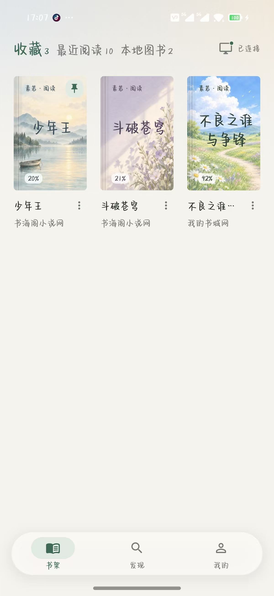
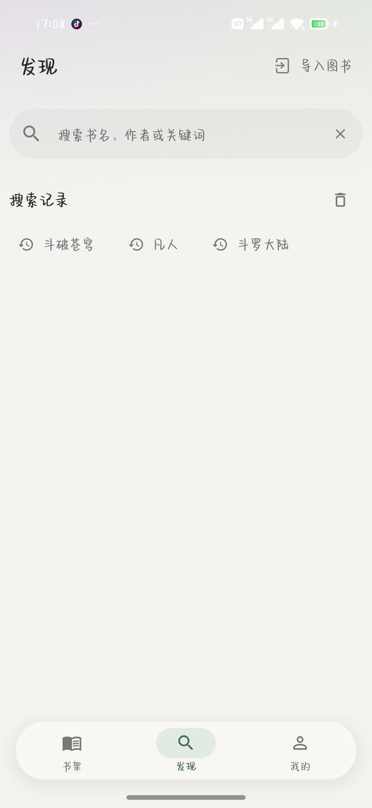
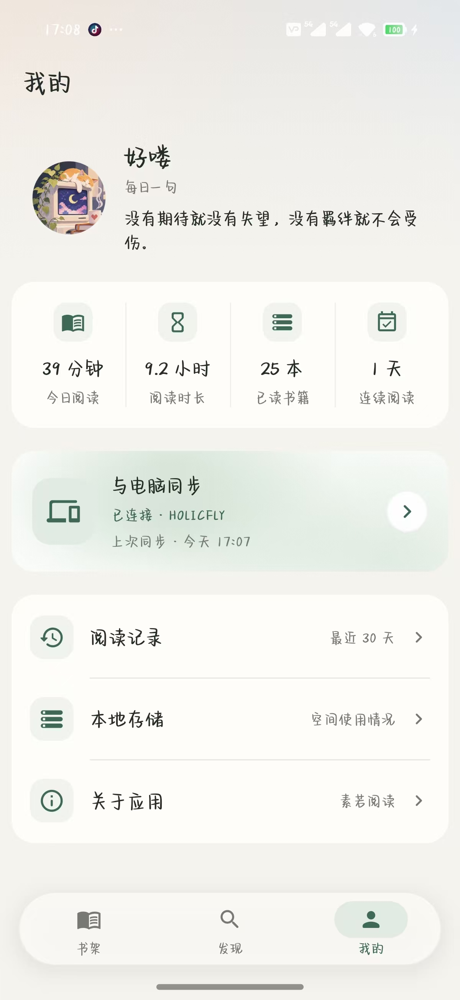
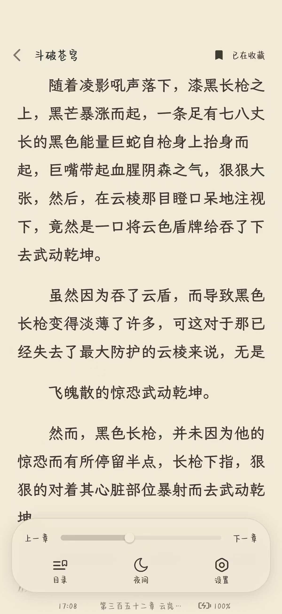
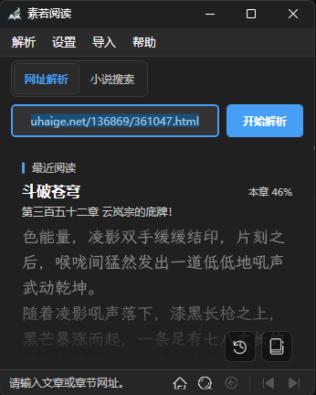
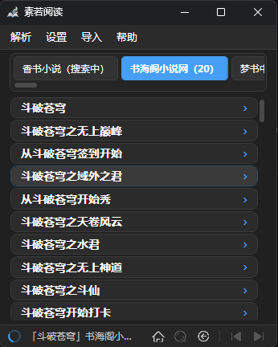
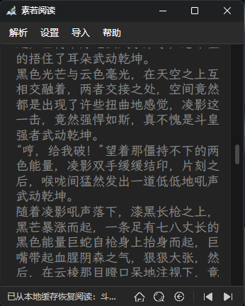
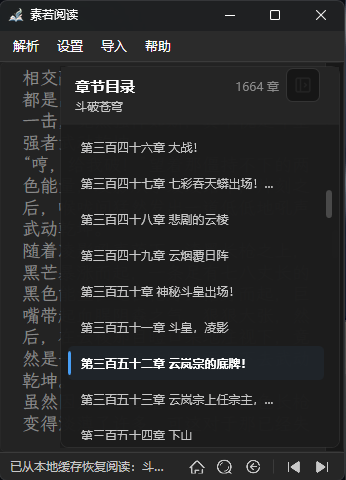
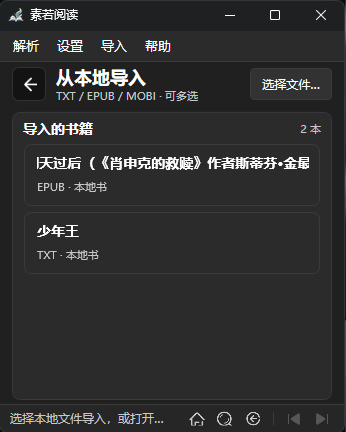

<p align="center">
  
</p>

<h1 align="center">素若阅读</h1>

<p align="center">
  <sub>轻量小说与文章阅读器</sub><br>
  <sub>在线找书 · 网页正文解析 · 本地导入 · 手机电脑互联</sub>
</p>


> [!IMPORTANT]
> **AI 开发提示**
>
> 本程序主要由 AI 协助完成设计、编码、重构和文档整理。受限于 AI 的理解与测试覆盖，项目仍可能存在不足、兼容性问题或未发现的缺陷，敬请谅解，也欢迎通过 Issue 提交可复现的问题和改进建议。

**相关 AI 与开源项目**

- [DeepSeek 开源主页](https://github.com/deepseek-ai)
- [OpenAI Codex](https://github.com/openai/codex)
- [ZCode](https://zcode.z.ai/)
- [DeepSeek Harness](https://github.com/deepseek-ai/deepseek-harness)

## 下载

在 [GitHub Releases](https://github.com/Holicfly/Sorryread/releases) 查看已公开的安装包。也可直接打开 [最新发行](https://github.com/Holicfly/Sorryread/releases/latest) 查看发行说明和附件。

## 使用说明

### 电脑端 · Windows 10 / 11 x64

1. 从 Releases 下载 `Sorryread-Setup-<版本>-x64.exe`。
2. 双击运行安装程序，根据提示选择安装位置。默认安装到 `C:\Program Files\Sorryread`。
3. 根据需要保留或取消「创建桌面快捷方式」，然后完成安装。
4. 启动「素若阅读」，可以直接输入章节网址，也可以使用小说搜索进入书籍详情和章节目录。
5. 在「小说搜索」上单击可选择聚合搜索或「我的书城网」入口。
6. 阅读过程中可切换上一章、下一章、目录、书库、历史记录及透明阅读模式。

### 手机端 · Android 8.0 及以上

1. 在发行附件中选择适合设备架构的 APK，在手机上打开并按系统提示安装。
2. 在「发现」搜索书名，或粘贴章节网址。找到书籍后可查看目录并开始阅读。
3. 点「导入图书」选择 TXT、EPUB 或 MOBI 文件，从书架的「本地图书」打开。
4. 在阅读时点按正文区呼出工具栏，可收藏、切换章节、拖动进度或打开设置。之后可从书架继续阅读。

## 主要功能

### 电脑端

#### 🔎 网页正文解析

粘贴小说章节或文章网址后，软件会自动识别标题和正文，尽量过滤导航、广告、推荐列表等无关内容。同时支持识别上一章、下一章链接，方便连续阅读。请使用公开或有权访问的网页。

#### 📚 在线搜书

输入书名即可同时搜索多个在线书源，并分别展示各书源的搜索状态和结果。聚合搜索包含 16 个可搜索书源，其中包括「云书斋」。另可选择「我的书城网」，输入书籍 ID 或同站链接直接打开书籍。找到书籍后，可以继续查看书籍详情、章节目录并选择章节阅读。书源翻到实际末页后会保留已加载结果并停止继续翻页。

#### 🪟 透明背景阅读

正文解析完成后，按 `F12` 即可进入透明阅读模式，让窗口背景透明、主要保留正文文字。透明模式支持鼠标滚轮、方向键和翻页键阅读，再次按 `F12` 可返回普通界面。

在阅读窗口获得焦点时，音量−/音量+键也可分别用于向上/向下滚动。音量+键滚动到章节末尾后可继续进入下一章。

#### ⚡ 快捷键收起应用

按下全局快捷键 `Alt+M` 或 `Shift+E`，可以随时将应用收起到系统托盘，再次按下即可恢复。普通阅读和透明阅读状态下均可使用，即使当前正在操作其他程序也能触发。

#### 其他功能

- 书籍详情、章节目录、目录高亮和章节切换。
- 最近阅读、书库收藏、历史记录和阅读进度恢复。
- 各搜索入口的搜索记录分开保存。「我的书城网」的记录显示书名，可再次打开。
- 目录后续页加载失败时保留已获取章节，并提示目录未完整加载。
- 记住窗口位置、字体、字号、文字颜色和主题设置。
- 可在设置中调整方向键滚动距离，支持 1–100 行。
- 支持导入TXT、EPUB、MOBI，支持导出 TXT。
- 内置登录窗口，可保留网站登录状态。

### 手机端

#### 🔎 发现与书架

在线搜索结果可按书源查看，进入详情后可从章节目录开始读。在「书架」按收藏、最近阅读和本地图书查找书籍。内置 12 款随机封面。

#### 📖 阅读与设置

支持仿真翻页、上下滑动和无动画翻页，可调整亮度、护眼模式、字体、字号与配色。阅读工具栏提供目录和进度，可从上次的位置续读。

#### 📊 阅读记录与存储

在「我的」查看阅读记录、阅读时长和本地存储。可从书架管理导入的本地图书。

### 近期更新

| 客户端 | 更新内容 |
| --- | --- |
| Android 1.0.0 | 扩充书架封面，优化小说开书动画与封面加载，并调整阅读工具栏的收藏文案。 |
| Windows 1.1.13 | 设备互联沿用窗口尺寸并支持滚动，改进自动重连和首页续读预览，更新聚合搜索书源。 |
| Windows 1.1.11 | 完善本地图书导入和管理、首页续读预览及设备互联入口，支持兼容本地图书的双端文件同步。 |

## 手机与电脑互联

1. 让手机和电脑接入同一 Wi-Fi 或热点，打开两端的素若阅读。
2. 在电脑打开「设置 → 设备互联 → 二维码展示」。
3. 手机从「书架」或「我的」进入「与电脑同步」，点「连接新设备」并扫码，再在电脑确认。
4. 配对完成后，两端可同步收藏、最近阅读和阅读位置。兼容的本地图书还可以同步原文件、目录和阅读进度。

手机同步页提供「立即同步」和同步记录。断开连接后会保留配对，可稍后重新连接。需要更换设备时，可解除配对再重新扫码。两个客户端也可独立找书、导入和阅读。

## 数据与隐私

Windows 优先使用程序目录下的 `Data\`。该目录不可写时，使用 `%LOCALAPPDATA%\Sorryread\`。

```text
数据目录\
├─ sorryread.db    设置、历史、书库和正文缓存
├─ WebView2\       浏览器 Cookie 与缓存
└─ txt\            用户主动导出的 TXT
```

Android 的书架、阅读记录、缓存和导入文件保存在应用私有存储中。设备互联在局域网内进行。

本仓库和安装包均不包含用户数据库、Cookie、网页缓存、用户导出的 TXT、日志或其他个人记录。

## 开发者说明

### 技术栈

| 客户端 | 技术 |
| --- | --- |
| Windows | .NET 8 / WPF、Microsoft Edge WebView2、SQLite（`Microsoft.Data.Sqlite`）、AngleSharp。使用 PowerShell 构建发行包。 |
| Android | Flutter / Dart、Android SDK、Kotlin、SQLite（Drift）。 |

### 项目结构

```text
Sorryread/
├─ src/
│  ├─ App/              应用生命周期、主题和路径管理
│  ├─ UI/               主窗口、子窗口、控件和对话框
│  ├─ Parsing/          网页正文和书源规则解析
│  ├─ Search/           聚合搜索、搜索模型和书源目录
│  ├─ Data/             SQLite 与业务数据模型
│  ├─ Services/         热键、托盘和 TXT 导出
│  └─ Sync/             设备互联和同步服务
├─ assets/
│  ├─ icons/            应用图标
│  ├─ images/           界面图片资源
│  └─ themes/           WPF 浅色、深色及公共样式
├─ mobile/              Android 客户端
├─ shared/              跨端协议、书源规则和测试样例
├─ scripts/             应用发布构建脚本
├─ installer/           Windows 安装包配置
├─ docs/                详细开发文档和界面示例
├─ App.xaml             WPF 应用资源入口
├─ ReadAI.csproj        .NET 项目文件
├─ Directory.Build.props
├─ CONTRIBUTING.md
└─ LICENSE
```

Windows 和 Android 各自构建和运行，共享协议、规则与测试样例。更详细的架构与模块说明见 [桌面开发文档](docs/DEVELOPMENT.md)、[Android 开发文档](mobile/README.md) 和 [跨端开发约定](docs/CROSS_PLATFORM_DEVELOPMENT.md)。同步数据格式见 [设备同步协议](shared/contracts/device-sync-v1.md)。

### 本地构建

**Windows**

环境要求为 Windows 10/11 x64、.NET 8 SDK 和 Microsoft Edge WebView2 Runtime。在仓库根目录执行以下命令。

```powershell
dotnet restore .\ReadAI.csproj
dotnet build .\ReadAI.csproj -c Debug
```

**Android**

准备 Flutter SDK、Android SDK 和 JDK。在仓库根目录执行以下命令。

```powershell
cd .\mobile
flutter pub get
flutter build apk --debug
```

### 发布应用

**Windows**

在仓库根目录运行 [Build-ReadAI.ps1](scripts/Build-ReadAI.ps1)。

```powershell
powershell.exe -NoProfile -ExecutionPolicy Bypass -File .\scripts\Build-ReadAI.ps1 -Version 1.1.13
```

发布结果位于 `publish\Sorryread`。发布方式为 `win-x64` 自包含多文件版本，仅保留 `zh-Hans` 简体中文卫星资源，用户端不需要预装 .NET 8。

**Android**

在 `mobile/` 执行以下命令，生成 arm64 Release APK。APK 位于 `build/app/outputs/flutter-apk/`。

```powershell
flutter build apk --release --target-platform android-arm64
```

## 参与贡献

请阅读 [CONTRIBUTING.md](CONTRIBUTING.md)。提交解析问题时，请只提供可公开访问且有权分享的网址和脱敏后的必要信息，不要提交网页正文、Cookie、账号信息或本地数据库。

## 许可证

本项目使用 [MIT License](LICENSE)。

## 应用截图

### Android

<table>
  <tr>
    <th>书架</th>
    <th>发现</th>
    <th>我的</th>
    <th>阅读与工具栏</th>
  </tr>
  <tr>
    <td></td>
    <td></td>
    <td></td>
    <td></td>
  </tr>
</table>

### Windows

<table>
  <tr>
    <th>首页与续读预览</th>
    <th>小说搜索</th>
    <th>阅读界面</th>
  </tr>
  <tr>
    <td></td>
    <td></td>
    <td></td>
  </tr>
  <tr>
    <th>章节目录</th>
    <th>本地导入</th>
  </tr>
  <tr>
    <td></td>
    <td></td>
  </tr>
</table>

**切换说明** · 手机端连点「发现」标题或书架当前选中的「收藏 / 最近阅读」五次可切换对应视图，Windows 端双击「小说搜索」可在聚合搜索与 18mh 单独搜索间切换，书库标题连点五次可切换资源显示。
